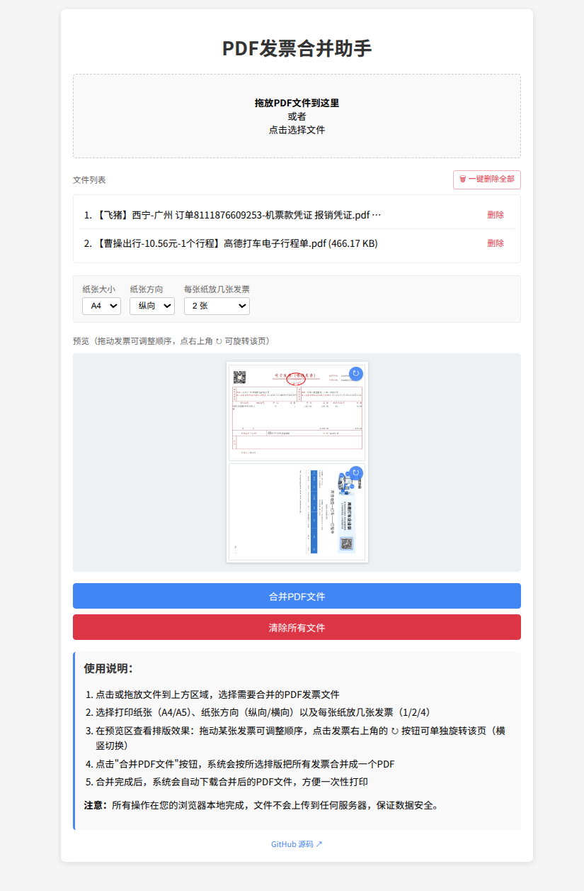

# pdf-merger

一个纯前端、零上传的 PDF 发票合并小工具，所有处理都在浏览器本地完成。

## 功能

- 拖放或点击上传多个 PDF 发票
- 文件列表展示，支持删除、**一键删除全部**
- **可选打印纸张**：A4 / A5，支持**纵向 / 横向**
- **网格排版**：每张纸放 1 / 2 / 4 张发票，自动铺成网格，省纸便于打印
- **可视化预览 + 拖动编排**：实时预览排版效果，拖动发票即可调整顺序
- **单页旋转**：点击预览中发票右上角的 ↻ 按钮，可单独旋转该页（横竖切换）
- 一键合并为单个 PDF 并自动下载
- 全程本地处理，文件不上传任何服务器

## 使用

直接打开 `index.html` 即可使用，或访问 GitHub Pages 部署的页面。

1. 上传需要合并的 PDF 发票
2. 选择纸张大小、方向、每张纸放几张发票
3. 在预览区拖动调整顺序、点 ↻ 旋转需要的页
4. 点击「合并 PDF 文件」，自动下载合并结果

## 技术

- [pdf-lib](https://github.com/Hopding/pdf-lib) — PDF 合并与排版
- [pdf.js](https://github.com/mozilla/pdf.js) — 预览渲染
- [FileSaver.js](https://github.com/eligrey/FileSaver.js) — 文件下载
